<p align="center">
  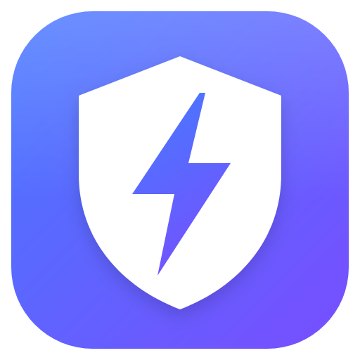
</p>

<h1 align="center">ByeDPI PC</h1>

<p align="center">
  Обход блокировок DPI для Windows, Linux и macOS — одна большая кнопка, выбор приложений и сайтов, автоподбор стратегии.<br>
  Десктопный аналог Android-приложения <a href="https://github.com/romanvht/ByeByeDPI">ByeByeDPI</a>.
</p>

<p align="center">
  
  
  
  
</p>

> **Это не VPN.** Программа не шифрует трафик, не скрывает ваш IP и никуда его не пересылает.
> Она локально «запутывает» первые пакеты соединения (TLS ClientHello, HTTP-заголовок), чтобы фильтр
> провайдера не распознал адрес сайта. Работает против блокировок по DPI/SNI — YouTube, Discord, RuTracker и т.п.

<p align="center">
  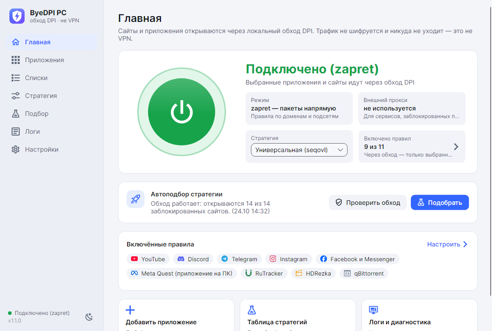
  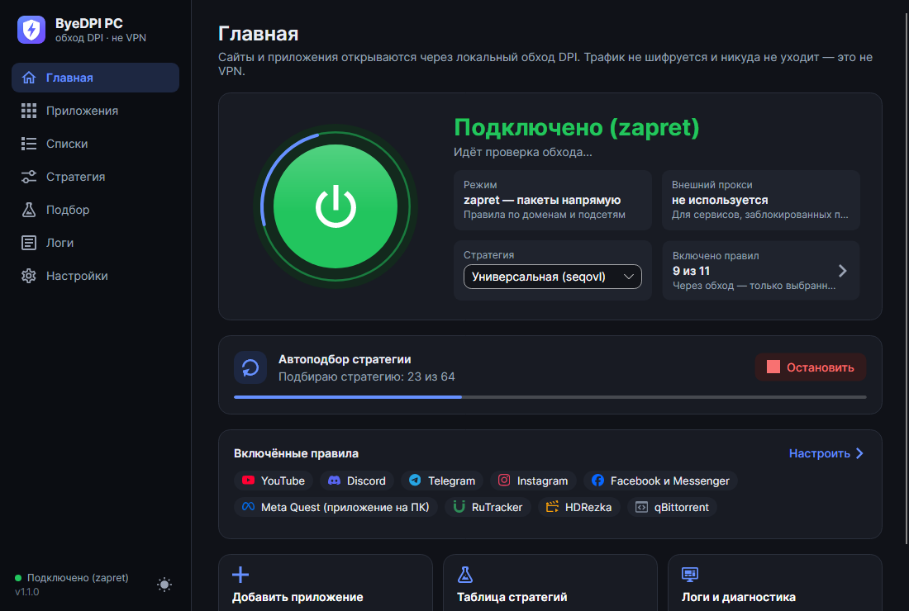
</p>

## Возможности

- **Одна кнопка.** Нажали — обход работает, цвет кнопки показывает состояние: серая — отключено, жёлтая — подключение, зелёная — работает, красная — ошибка.
- **Два движка:**
  - **zapret** (Windows, по умолчанию) правит пакеты напрямую через драйвер WinDivert и пробивает больше: YouTube, Instagram, Discord;
  - **byedpi** — локальный SOCKS, как в ByeByeDPI на Android; умеет правила по программам (режим TUN) и работает без прав администратора.
- **Автоподбор стратегии.** При первом подключении программа сама проверяет, какие сайты у вас заблокированы, и перебирает стратегии. Для zapret отдельная стратегия подбирается для YouTube/Google. Ход подбора виден на главной и в трее.
- **Подобранная стратегия запоминается.** При следующих подключениях — только быстрая проверка на 2–3 сайтах за пару секунд. Если провайдер поменял фильтр и обход перестал работать, программа предложит подобрать заново.
- **Выбор приложений и сайтов.** Галочка на программе (`Telegram.exe`, `Discord.exe`, любой `.exe`) или на наборе доменов — и они идут через обход, остальной трафик — напрямую.
- **Готовые наборы:** YouTube, Discord, Telegram, Instagram, Facebook и Messenger, Meta Quest (приложение на ПК), RuTracker, HDRezka; выключены по умолчанию — X (Twitter) и «Браузеры целиком».
- **Маршрут для каждого правила:** «Обход DPI», «Напрямую» или «Внешний прокси» — **VLESS Reality**, SOCKS5 или HTTP для сервисов, заблокированных по IP (обычно Telegram). Есть [инструкция по своему серверу «только Telegram»](docs/telegram-server.md) с личными ключами.
- **Обмен настройками.** Стратегию, правила и ключ внешнего прокси можно отправить другу файлом `.bdpi` или текстовым кодом; друг применяет их в один клик (или просто перетаскивает файл в окно).
- **Обновления из GitHub.** Программа сама сообщает о новой версии и обновляется одной кнопкой, настройки сохраняются.
- **Режимы фильтра, как в ByeByeDPI:** «Только выбранное», «Всё, кроме выбранного», «Весь трафик».
- **Два режима работы:**
  - **TUN** (рекомендуется) — виртуальный адаптер [sing-box](https://github.com/SagerNet/sing-box), правила работают для любых программ, DNS через DoH;
  - **Только прокси** — без драйверов и прав администратора: SOCKS5 `127.0.0.1:1080` + системный прокси с PAC-файлом (через обход идут только домены из правил).
- **Редактор стратегий:** простой режим с галочками и подсказками на русском или командная строка byedpi, несколько профилей, проверка запуска.
- **Подбор стратегий с таблицей:** проверка сайтов напрямую, затем через каждую стратегию — процент успеха, среднее время, «Применить лучшую».
- **Автозапуск** вместе с системой (на Windows — задача Планировщика с правами администратора, поэтому TUN поднимается без запроса UAC), работа из трея, повторный запуск открывает уже запущенное окно.
- **Логи и диагностика** понятным языком; ошибки показываются с кнопкой «Что делать?».
- **Светлая и тёмная тема**, плавные анимации; окно растягивается только до разумного размера.
- **Аккуратно с системой:** при отключении, выходе или падении программы TUN и системный прокси убираются, дочерние процессы завершаются вместе с программой.

## Скриншоты

| | |
|---|---|
| 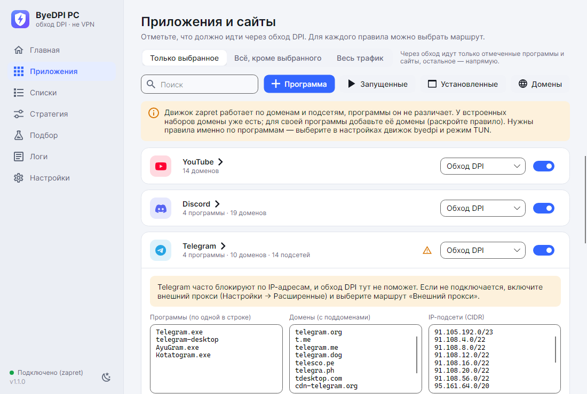 | 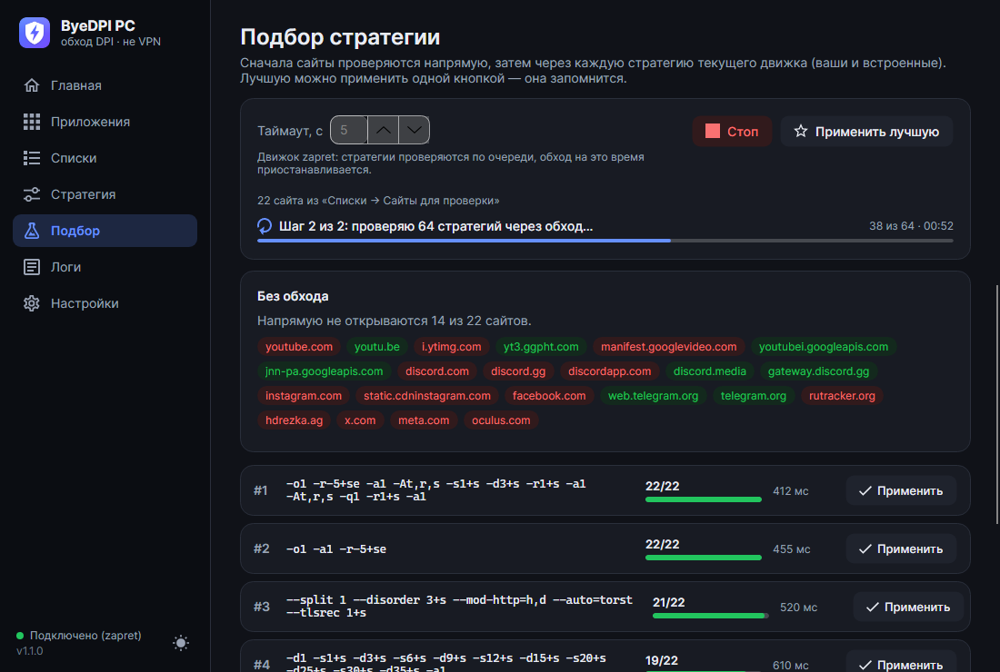 |
| **Приложения и сайты** — пресеты, свои программы, маршрут для каждого правила | **Подбор** — проверка напрямую и через каждую стратегию |
| 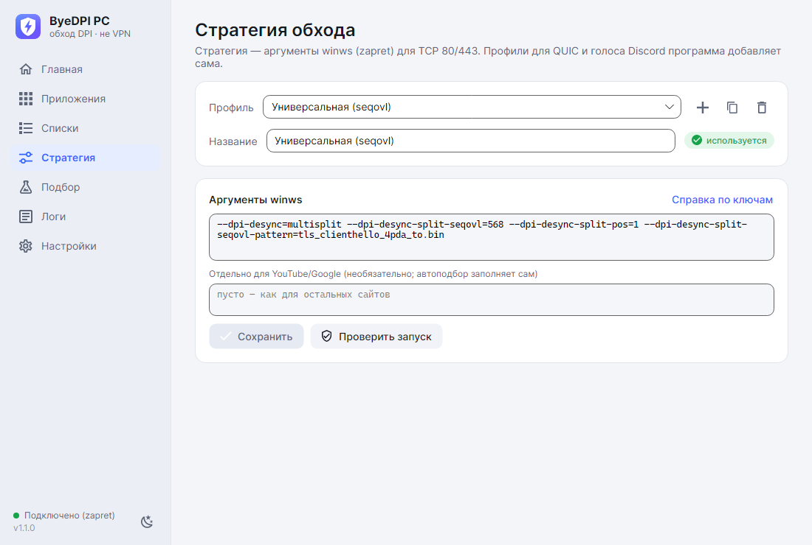 | 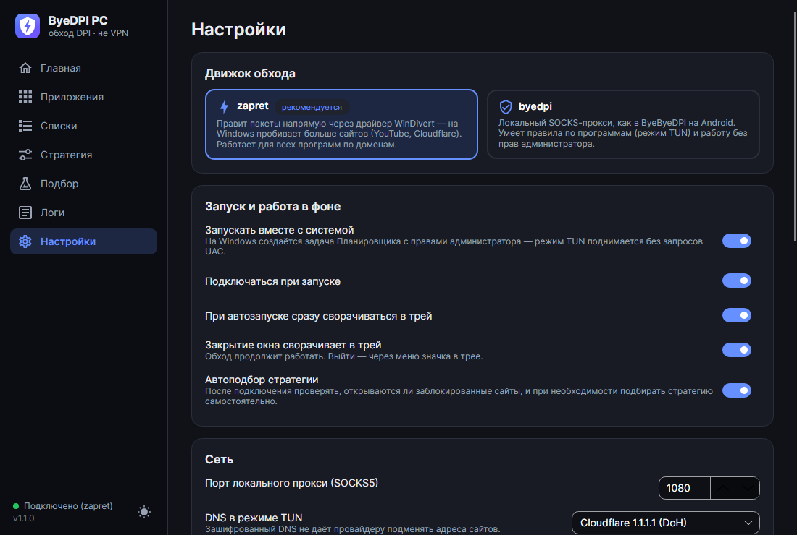 |
| **Стратегия** — простой режим или командная строка byedpi | **Настройки** — режим работы, автозапуск, DNS, внешний прокси |
| 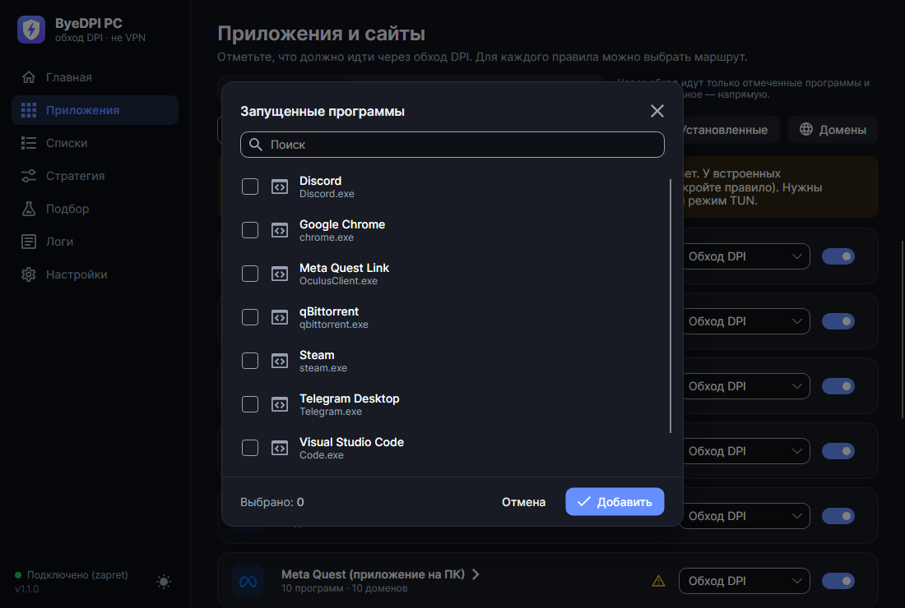 | 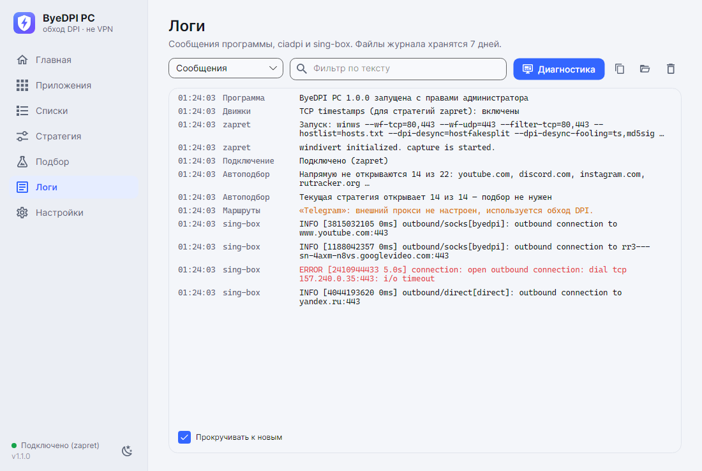 |
| **Выбор из запущенных или установленных программ** | **Логи и диагностика** |
| 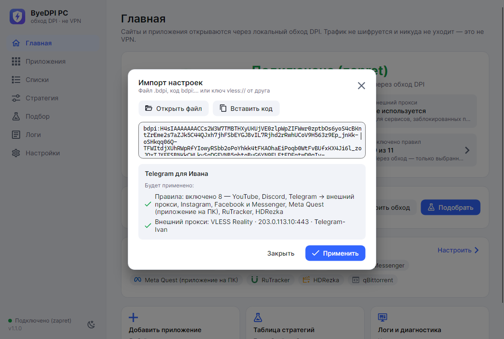 | 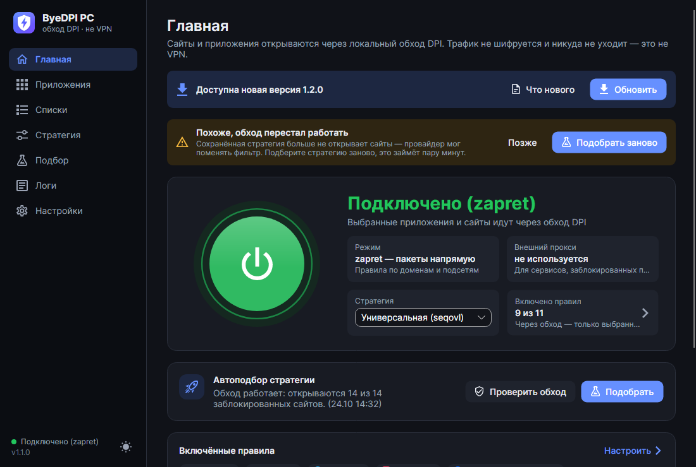 |
| **Импорт файла доступа** — например, ключа к серверу для Telegram | **Новая версия и подсказка, если обход перестал работать** |

<details>
<summary>Ещё скриншоты</summary>

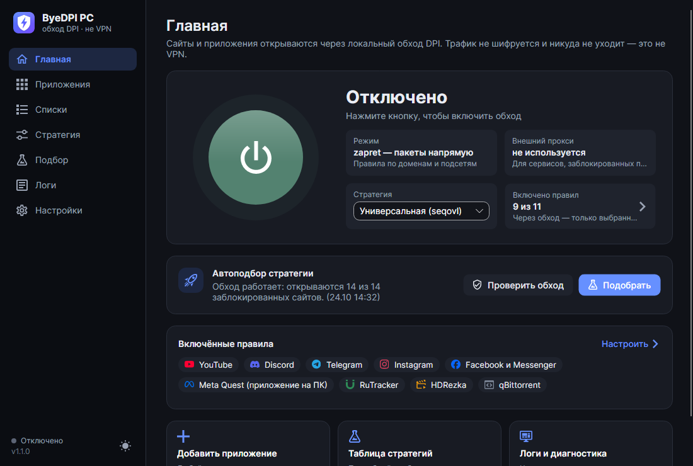
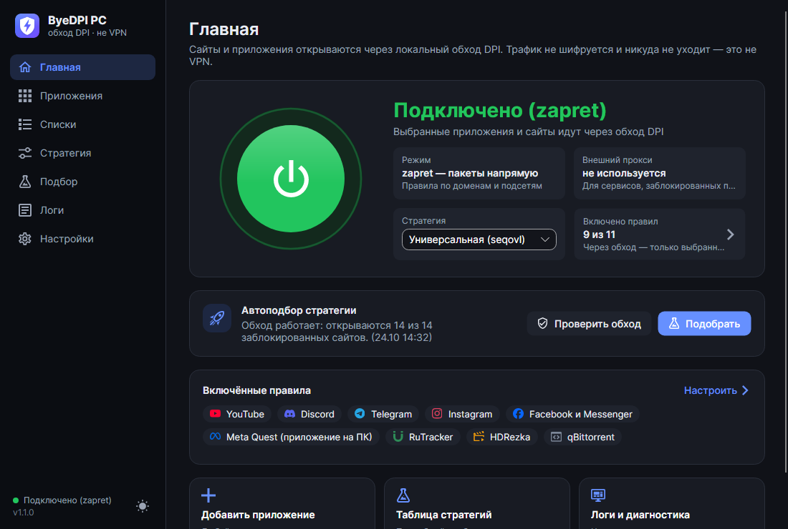
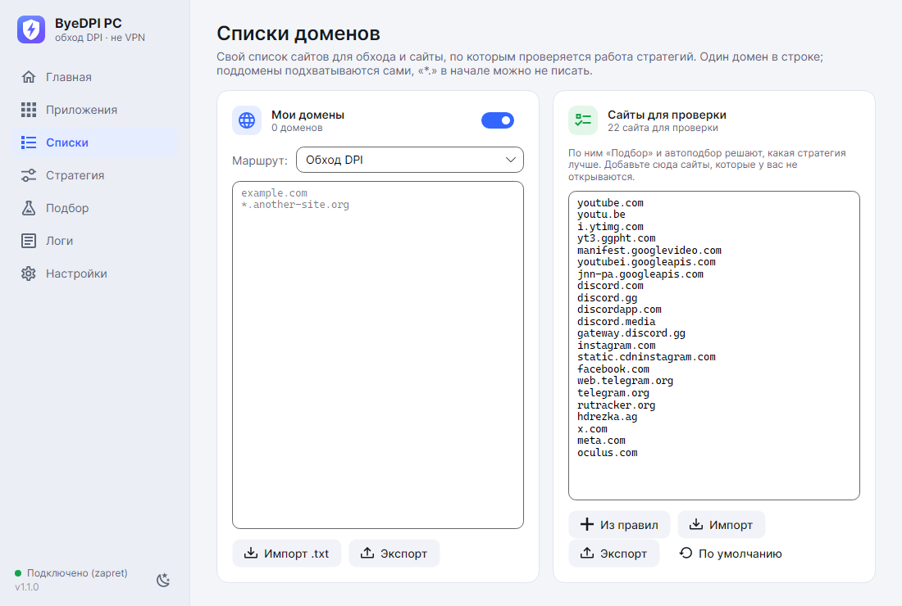
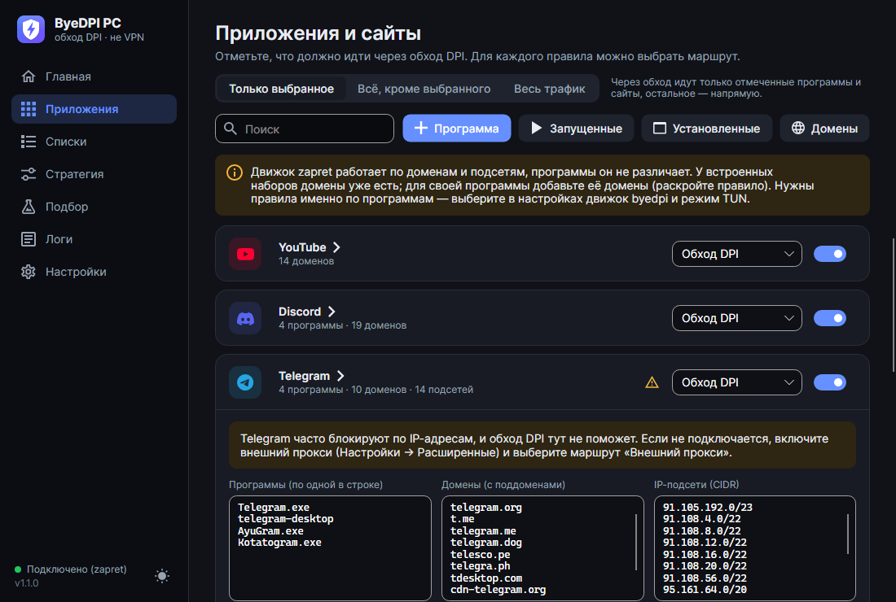
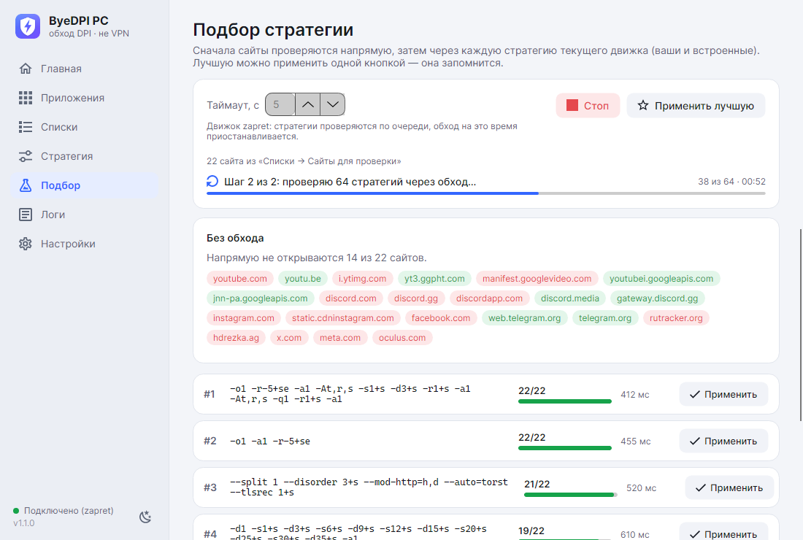
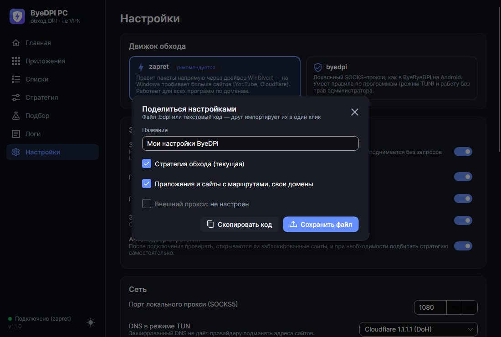
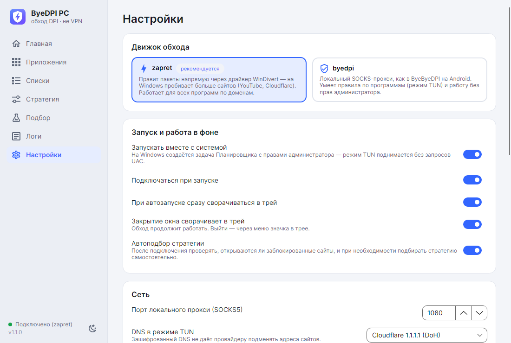
</details>

## Установка

1. Скачайте архив для своей системы со страницы [Releases](../../releases) и распакуйте в любую папку.
2. Запустите `ByeDPI-PC.exe` (Linux/macOS — `ByeDPI-PC`).
3. Нажмите большую кнопку. Windows спросит права администратора: они нужны драйверу WinDivert (zapret) или виртуальному адаптеру (TUN). При первом подключении программа сама подберёт стратегию под вашего провайдера, это занимает 2–3 минуты, а дальше подключение мгновенное.

Чтобы не подтверждать права при каждом запуске, включите **Настройки → Запускать вместе с системой**: программа создаст задачу Планировщика и будет стартовать с нужными правами, свёрнутой в трей, и сама подключаться.

> Антивирусы иногда ругаются на утилиты обхода DPI. Движки в архиве — официальные сборки
> [byedpi](https://github.com/hufrea/byedpi/releases) и [sing-box](https://github.com/SagerNet/sing-box/releases),
> их SHA256 сверяются при сборке (см. [`scripts/engines.ps1`](scripts/engines.ps1)).

## Как пользоваться

- **Главная** — кнопка подключения, текущая стратегия (переключается из списка), карточка автоподбора: «Проверить обход» и «Подобрать».
- **Приложения** — отметьте нужное. Кнопки сверху: «Программа» (выбрать `.exe`), «Запущенные», «Установленные», «Домены» (свой набор). Раскройте правило, чтобы поправить список программ, доменов и подсетей.
- **Списки** — свои домены (по одному в строке, импорт/экспорт `.txt`) и сайты, по которым проверяются стратегии. Добавьте туда сайты, которые не открываются именно у вас.
- **Стратегия** — редактирование аргументов [byedpi](https://github.com/hufrea/byedpi#readme).
- **Подбор** — подробный перебор стратегий с таблицей результатов.
- **Логи** — что происходит, плюс кнопка «Диагностика».

### Telegram

Telegram у многих провайдеров блокируют **по IP-адресам**: соединение с его серверами просто не устанавливается, и никакой обход DPI (ни byedpi, ни zapret) тут не поможет. Нужен сервер за границей:

- поднимите свой сервер по [инструкции](docs/telegram-server.md). Это одна команда, сервер пропускает только Telegram, у каждого друга свой ключ;
- или получите у знакомого **файл доступа** `.bdpi` либо код и импортируйте его: **Настройки → Обмен настройками → Импорт**. Telegram сразу пойдёт через сервер.

Ключ можно вставить и вручную: **Настройки → Расширенные → Внешний прокси** (`vless://…`, `socks5://…`, `http://…`), затем у правила Telegram выбрать маршрут «Внешний прокси».

### Обмен настройками

**Настройки → Обмен настройками → Поделиться**: выберите, что передать (стратегию, правила, ключ внешнего прокси), и сохраните файл `.bdpi` или скопируйте код `bdpi:…`. Друг открывает его через «Импорт» или перетаскивает файл в окно и видит, что изменится, до того как применит.

### Если сайт не открывается

- Нажмите на главной **«Подобрать»** или откройте вкладку **«Подбор»**: стратегии сильно зависят от провайдера.
- Выключите другие VPN (AmneziaVPN, WireGuard, OpenVPN): они перехватывают трафик и мешают режиму TUN. Программа предупредит, если увидит такой адаптер.
- На Windows используйте движок **zapret** (выбран по умолчанию). byedpi на Windows работает через обычный сокет, и приёмы вроде `disorder` и `fake` ведут себя иначе, чем на Android ([подробнее](https://github.com/hufrea/byedpi#readme)). zapret правит пакеты напрямую и пробивает больше.
- Для части стратегий zapret программа включает в Windows TCP timestamps (`netsh interface tcp set global timestamps=enabled`), так же делает zapret-discord-youtube. Это безопасная системная настройка: в Linux она включена по умолчанию.
- Если «Подбор» показывает, что сайт не открывается ни одной стратегией, скорее всего, он заблокирован по IP. Тогда поможет только внешний прокси.

### Meta Quest

Набор «Meta Quest» рассчитан на приложение **Meta Quest Link** на этом компьютере (вход, магазин, загрузки).
Сам шлем по Wi-Fi через эту программу не настраивается.

## Linux и macOS

Интерфейс написан на [Avalonia](https://avaloniaui.net) и запускается на Linux и macOS.

- Движки: `scripts/fetch-engines.sh` скачает byedpi (Linux) или соберёт его из исходников (macOS, нужны `make` и `clang`), а также sing-box.
- Права для TUN запрашиваются через `pkexec` (Linux) или системное окно пароля (macOS).
- Системный прокси: GNOME (`gsettings`) и macOS (`networksetup`).
- Автозапуск: `~/.config/autostart` и `~/Library/LaunchAgents`.

Основная разработка и проверка ведутся на Windows; на Linux и macOS режим TUN пока проверен меньше — сообщайте о проблемах в Issues.

## Сборка из исходников

Нужен [.NET SDK 8](https://dotnet.microsoft.com/download).

```powershell
# Windows
powershell -ExecutionPolicy Bypass -File scripts\fetch-engines.ps1   # движки в engine\win-x64
dotnet run --project src\ByeDpiPc.App                                # запуск
dotnet test tests\ByeDpiPc.Core.Tests                                # тесты
powershell -ExecutionPolicy Bypass -File scripts\publish.ps1         # портативный архив в dist\
```

```bash
# Linux / macOS
scripts/fetch-engines.sh
dotnet run --project src/ByeDpiPc.App
```

Вспомогательные утилиты: `tools/IconGen` рисует иконки программы и трея, `tools/Screenshots` рендерит скриншоты для README без окна (Avalonia Headless).

### Устройство

```
src/ByeDpiPc.Core     модели и настройки, пресеты, командные строки ciadpi и winws, конфиг sing-box и PAC,
                      запуск движков (Job Object), помощник с правами администратора, системный прокси,
                      VLESS, подбор и автоподбор стратегий, обмен настройками, обновления, диагностика
src/ByeDpiPc.App      интерфейс Avalonia (MVVM), трей, единственный экземпляр
tests/                тесты генераторов конфигов и разбора стратегий (в том числе `sing-box check`)
scripts/              загрузка движков с проверкой SHA256, сборка релиза
docs/server/          скрипты сервера «только Telegram» (sing-box, VLESS Reality, личные ключи)
```

Как это работает: в режиме **zapret** `winws` через драйвер WinDivert перехватывает исходящие пакеты к сайтам из правил (по SNI/Host и подсетям) и сам переставляет, режет и подделывает их. В режиме **byedpi** `ciadpi` поднимает локальный SOCKS5 на `127.0.0.1`. В режиме TUN `sing-box` создаёт
виртуальный адаптер и по правилам (имя процесса, домен, подсеть) отправляет нужный трафик в этот SOCKS, остальное — напрямую;
трафик самих `ciadpi` и `sing-box` всегда идёт напрямую, чтобы не было петли. Права администратора нужны только
процессу-помощнику с sing-box: если основная программа закрылась или упала, помощник останавливает sing-box и адаптер исчезает.

## Приватность

Никакой телеметрии. Программа обращается в интернет только при проверке сайтов (подбор стратегии, диагностика) — к сайтам из вашего списка.

## Благодарности и лицензии

ByeDPI PC распространяется под лицензией [GPL-3.0](LICENSE).

- [ByeByeDPI](https://github.com/romanvht/ByeByeDPI) (romanvht, GPL-3.0) — идея, логика подбора, набор стратегий и сайтов для проверки. Перенесённые фрагменты помечены ссылками на исходные файлы.
- [byedpi](https://github.com/hufrea/byedpi) (hufrea, MIT) — движок обхода `ciadpi`, поставляется отдельным файлом.
- [zapret](https://github.com/bol-van/zapret) (bol-van, MIT) — движок `winws` с драйвером [WinDivert](https://reqrypt.org/windivert.html) (LGPL-3.0); стратегии и фейковые пакеты основаны на [zapret-discord-youtube](https://github.com/Flowseal/zapret-discord-youtube) (Flowseal, MIT).
- [sing-box](https://github.com/SagerNet/sing-box) (SagerNet, GPL-3.0-or-later) — маршрутизация TUN, поставляется отдельным файлом; использует драйвер [wintun](https://www.wintun.net).
- [Avalonia](https://github.com/AvaloniaUI/Avalonia) (MIT), [CommunityToolkit.Mvvm](https://github.com/CommunityToolkit/dotnet) (MIT), шрифт [Inter](https://rsms.me/inter/) (OFL).
- Иконки: [Material Design Icons](https://pictogrammers.com/library/mdi/) (Apache 2.0) и [Simple Icons](https://simpleicons.org) (CC0). Логотипы сервисов — товарные знаки их владельцев и используются только для обозначения.

Лицензии движков лежат рядом с ними в `engine/LICENSES`.
